# Core Banking Service RESTful CLI

A secure, web-based Java banking application that integrates session-based authentication and strict validation algorithms to safely process financial transactions and persist user account details.

## 🚀 Key Features

* **Session-Based Authentication:** Manages explicit user states and active sessions to safely authorize sensitive account actions.
* **Strict Data Validation:** Utilizes robust server-side algorithms to verify user credentials and transaction parameters before persistence.
* **Comprehensive CLI Layer:** Enables authenticated users to securely deposit, withdraw, and transfer funds via an interactive command-line interface.
* **Transactional Security:** Features an isolated Data Access Object (DAO) architecture to safely manipulate accounts without data leaks.

## 🛠️ Tech Stack

### Frontend & Client-Side
* **HTML5 / CSS3:** Accessible, structural layout styled for a clean and readable user experience.
* **JavaScript (ES6):** Dynamic client-side interactions and asynchronous state management.

### Backend Core & Architecture

| Technology | Role |
| :--- | :--- |
| **Java** | Core OOP language driving business and transaction logic. |
| **MVC Architecture** | Design pattern cleanly separating models, views, and the CLI execution layer. |
| **XML Schemas** | Structuring and validation definitions for secure data modeling and exchange. |

### Security, Data & Devops
* **PostgreSQL:** Relational database management system storing credentials and account ledger balances.
* **Connection Factory Pattern:** Design pattern managing and pooling active SQL database connections efficiently.
* **Gradle Wrapper:** Build automation tool guaranteeing deterministic compilations and dependency trees.
* **Apache Log4j:** Enterprise-grade logging for transaction auditing, threat monitoring, and system debugging.

## 🧪 Testing

The repository ships with isolated unit testing suites to ensure system integrity:
* **DAO Verification:** Automated tests validating CRUD operations against account objects.
* **Connection Stability:** Unit tests enforcing that the database connection factory cleanly signs and terminates active pools.

## System Architecture Diagram (Landscape Format)

```mermaid
graph LR
    %% Styling Definitions
    classDef client fill:#2d3748,stroke:#4a5568,stroke-width:2px,color:#fff;
    classDef controller fill:#2b6cb0,stroke:#2b6cb0,stroke-width:2px,color:#fff;
    classDef logic fill:#2c7a7b,stroke:#2c7a7b,stroke-width:2px,color:#fff;
    classDef database fill:#d69e2e,stroke:#b7791f,stroke-width:2px,color:#fff;
    classDef logging fill:#e53e3e,stroke:#c53030,stroke-width:2px,color:#fff;

    %% Tier 1: Client Interfaces
    subgraph Tier_1 [Tier 1: Client Interfaces]
        A[Web Browser UI<br/>HTML5 / CSS3 / ES6 JS]:::client
        B[Terminal CLI<br/>Interactive Command Line]:::client
    end

    %% Tier 2: Controller & Security Layer
    subgraph Tier_2 [Tier 2: Controller & Security]
        C[Session-Based<br/>Auth Manager]:::controller
        D[Application Controllers<br/>MVC Design Pattern]:::controller
    end

    %% Tier 3: Core Business & Persistence Layer
    subgraph Tier_3 [Tier 3: Core Business & Persistence]
        E[Validation Engine<br/>XML Schemas]:::logic
        F[Isolated Data Access Objects<br/>DAO Architecture]:::logic
    end

    %% Tier 4: Database Infrastructure & Observability
    subgraph Tier_4 [Tier 4: Data & Logging]
        G[Connection Factory<br/>Pooling]:::database
        H[(PostgreSQL Database<br/>Ledgers & Credentials)]:::database
        I[Apache Log4j<br/>Audit & Monitoring]:::logging
    end

    %% Architectural Relationships & Data Flow
    A -->|HTTP REST| C
    C -->|Auth State| D
    B -->|JVM Exec| D
    
    D -->|Payload| E
    E -->|Validation Pass| F
    
    F -->|Request SQL Conn| G
    G -->|Pooled Active Session| H
    F -->|CRUD Ledger| H
    
    %% Async Logging Hooks
    E -.->|Failures| I
    F -.->|Audit Trails| I

    %% Layout Flow Settings
    style Tier_1 fill:#f7fafc,stroke:#edf2f7,stroke-dasharray: 5 5
    style Tier_2 fill:#f7fafc,stroke:#edf2f7,stroke-dasharray: 5 5
    style Tier_3 fill:#f7fafc,stroke:#edf2f7,stroke-dasharray: 5 5
    style Tier_4 fill:#f7fafc,stroke:#edf2f7,stroke-dasharray: 5 5
```



---

## 🚀 Technical Challenges & Solutions

*   **Challenge: Concurrency and Thread Safety in Financial Ledger Balances**
  
    *   **Problem:** Allowing users to execute transactions simultaneously across both the Web UI and the CLI layer introduced race conditions, creating a high risk of balance duplication or data corruption.
    *   **Solution:** Architected an **Isolated Data Access Object (DAO) pattern** backed by strict transaction isolation levels in PostgreSQL to serialize state updates. By separating structural execution layers from backend persistence, the application cleanly prevents internal data leaks and enforces deterministic ledger updates during high-throughput workloads.

*   **Challenge: Inefficient Database Connection Overhead and Lifecycles**
  
    *   **Problem:** Establishing a fresh SQL connection for every independent web request or CLI transaction command created heavy infrastructure overhead, leading to slower response times and connection drops under stress.
    *   **Solution:** Implemented the **Connection Factory Pattern** to instantiate and maintain an efficient connection pool. This design pattern automates connection signing, recycling, and termination lifecycles, dropping database initialization latency while guaranteeing that idle connections are safely cleaned up without resource leaks.

*   **Challenge: Exploitation Risks via Malformed Payload Injection**
  
    *   **Problem:** Accepting unvalidated transactional payloads and financial parameters directly from client entry points exposed the backend to security vulnerabilities and unstable business logic inputs.
    *   **Solution:** Built a robust, server-side validation engine powered by strict **XML Schemas**. Incoming data is thoroughly parsed, checked for structural data integrity, and cross-referenced against session-based authentication states before any transaction processing logic occurs, completely isolating the backend from malicious or corrupted inputs.


To run the test suite locally:
```bash
./gradlew test
```

## ⚙️ Getting Started

### Prerequisites
* **Java Development Kit (JDK):** Version 11 or higher.
* **PostgreSQL:** An active instance with a configured database schema.

### Installation & Run
1. **Clone the repository:**
   ```bash
   git clone https://github.com
   cd core-banking-service
   ```
2. **Build the application:**
   ```bash
   ./gradlew build
   ```
3. **Execute the application:**
   ```bash
   ./gradlew bootRun
   ```

## 📜 License
This project is licensed under the MIT License - see the [LICENSE](LICENSE) file for details.
